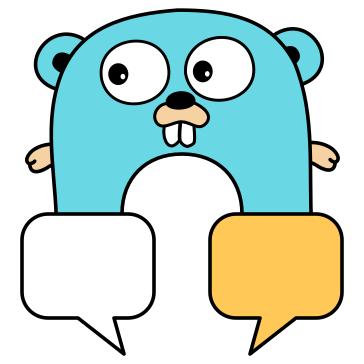

# bridgery

*A hackable bridge for chat platforms*

**bridgery** relays messages between chat platforms, so people on Discord, IRC, and elsewhere can all chat with eachother.

## Features

Not every platform supports every feature, the **[platform list](docs/platforms)** shows what each one can do.

- [x] Bridge channels across platforms
- [x] Replies, edits, and deletes
- [x] Files and attachments
- [x] Puppeting, so bridged users show up with their own name and avatar
- [x] Lua hooks to rewrite, filter, or drop messages

## Getting started

Read the **[setup guide](docs/SETUP.md)** for a walkthrough.

## Contributing

...

### Chat with us

If you'd rather like to see the bridge in action, join us in these channels. All of them are bridged with eachother.

- **Discord:** [discord.gg/U4GRHqY79e](https://discord.gg/U4GRHqY79e)
- **XMPP:** [bridgery@conference.oss.zone](https://join.jabber.network/#bridgery@conference.oss.zone?join)
- **IRC:** [#bridgery on libera.chat](https://web.libera.chat/#bridgery)

## Related projects

- **[matterbridge](https://github.com/42wim/matterbridge)** (and [the fork](https://github.com/matterbridge-org/matterbridge)): pretty much the only mature cross-platform bridge to date

## Credits

### Logo

- Go gopher by [Renée French](https://reneefrench.blogspot.com/), licensed under [CC BY 4.0](https://creativecommons.org/licenses/by/4.0/)
- Gopher artwork from [gopher-vector](https://github.com/golang-samples/gopher-vector) by Takuya Ueda, licensed under [CC BY 3.0](https://creativecommons.org/licenses/by/3.0/)
